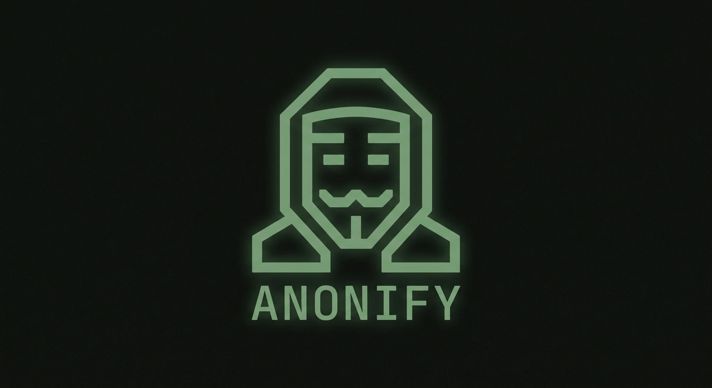
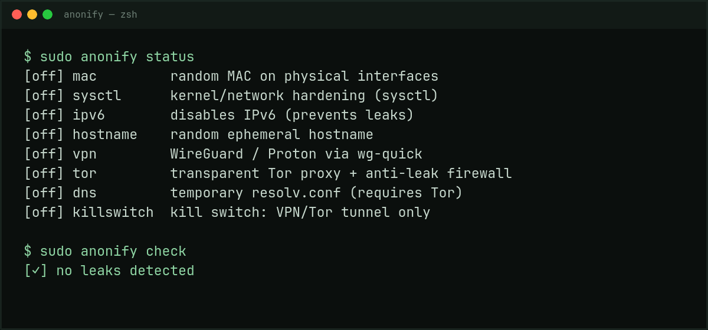

# anonify

<p align="center">
  
</p>

<p align="center">
  <strong>Network anonymity for Linux that undoes itself.</strong><br>
  One command layers MAC and hostname randomization, IPv6/DNS leak prevention, Tor or WireGuard behind a<br>
  fail-closed kill switch, and a per-app sandbox. <code>anonify restore</code> puts the machine back exactly as it was.
</p>

<p align="center">
  <a href="https://github.com/grubberdubber/anonify/actions/workflows/ci.yml"></a>
  <a href="LICENSE"></a>
  <a href="https://www.rust-lang.org/"></a>
  
  
  <a href="https://github.com/grubberdubber/anonify/releases"></a>
  <a href="#support-this-project"></a>
</p>

<p align="center">
  
</p>

```bash
git clone https://github.com/grubberdubber/anonify.git && cd anonify
cargo build --release && sudo install -m755 target/release/anonify /usr/local/bin/
sudo anonify enable --all      # then: sudo anonify check · undo: sudo anonify restore
```

---

## Overview

`anonify` applies temporary, reversible network-anonymity hardening on Linux. Its own state lives in volatile memory (`/run/anonify`, kernel `sysctl` values, `nftables` tables, bind mounts) — it does not write secrets or activity history to persistent storage, and a reboot or `anonify restore` returns the machine to its original network configuration. Third-party tools that `anonify` invokes (for example `wg-quick` or NetworkManager) may touch system runtime state; `anonify` documents that and restores it on a best-effort basis.

It exists because most "anonymity scripts" in circulation are ad-hoc shell scripts that silently fail halfway through, leak traffic over IPv6 or background DNS, or leave the firewall and network stack in a broken, half-applied state. `anonify` is built with real error handling, automatic rollback (a failed layer rolls back the ones already applied), and continuous drift detection, so it can tell you if something else on the system — NetworkManager, a daemon — reverted a change behind its back.

### How it compares

| What people usually reach for | What it gives you | What `anonify` adds on top |
| --- | --- | --- |
| `macchanger` + a shell script | A new MAC, if nothing fails halfway | MAC, hostname, `sysctl`, IPv6, DNS, tunnel and firewall as **one state**, with verified rollback |
| A VPN client | An encrypted tunnel | Kill switch, IPv6 off, DNS pinned, and a leak check that refuses to phone home over the clear net |
| `firejail` / `bwrap` alone | An app sandbox | The sandbox **plus** network-layer hardening, and a child with no capabilities and no logins |
| `nft` rules by hand | Full control, easy to lock yourself out | Tested table, `restore`, and drift detection when something deletes it |
| Tails / Whonix | A whole hardened OS | No reboot, no VM: ephemeral changes on the Linux you already run, undone in seconds |

`anonify` is not a replacement for Tor Browser, Tails or Whonix when your threat model includes a global adversary. It is the layer those setups assume you already have: a machine that does not shout its MAC, hostname, DNS and IPv6 at every network it joins.

> **If this saves you an afternoon of `nft` debugging, [a star](https://github.com/grubberdubber/anonify) helps other people find it — and [sponsorship](#support-this-project) pays for the bridge/VPN test matrix.**


> **Scope and ethics.** `anonify` is a privacy and network-hardening tool, not an anti-forensics tool. It never deletes, truncates, redirects, or tampers with system logs, audit records, shell histories, file timestamps, or evidence. It does not disable auditing or hide activity. Features that would obstruct an investigation are out of scope and are rejected in review. See [AGENTS.md](AGENTS.md) and the [Legal & Disclaimer](#legal--disclaimer) section.

## Who this is for

`anonify` is aimed at:

- Privacy-conscious individuals who want their machine's network fingerprint (MAC address, hostname, DNS, IPv6) to not trivially identify them to a local network, ISP, or passive observer.
- Security researchers and red-team operators running **authorized**, scoped engagements who need a controlled, auditable way to vary network-layer identifiers between test sessions.
- Journalists, researchers, and others operating under real threat models who need defense-in-depth against network-level tracking.

It is **not** a tool for evading law enforcement investigation, destroying evidence, or hiding wrongdoing. See the Legal & Disclaimer section below.

## Features

| Module       | What it does                                                                                                                                        | How it's reverted                                                       |
| ------------ | --------------------------------------------------------------------------------------------------------------------------------------------------- | ----------------------------------------------------------------------- |
| `mac`        | Randomizes the MAC address on physical interfaces. By default it uses a locally administered address (no vendor); `--mac-vendor` picks a real OUI family when a network rejects those. | Restores the original MAC via `ip link`.                                |
| `hostname`   | Sets an ephemeral, randomized hostname (`host-xxxxxxxx`).                                                                                           | Restores the original hostname.                                         |
| `sysctl`     | Kernel-level network hardening: ignores ICMP echo, disables TCP timestamps, blocks ICMP redirects, restricts `kptr`/`bpf` exposure.                 | Restores each key's exact previous value.                               |
| `ipv6`       | Disables IPv6 on all interfaces to eliminate IPv6 leak vectors.                                                                                     | Re-enables IPv6 with its previous value.                                |
| `dns`        | Temporary RAM-backed bind mount over `/etc/resolv.conf`, pinned to `127.0.0.1` so Tor's DNSPort redirect handles resolution. Requires `tor`.       | Unmounts `/etc/resolv.conf` immediately.                                |
| `tor`        | Fail-closed Tor setup: installs the redirecting/blocking `nftables` table **before** bootstrap, then runs an isolated Tor instance. `--tor-bridges <FILE>` adds bridges and pluggable transports (obfs4, snowflake, meek, webtunnel) for restrictive networks. | Tears down the `nftables` table and stops the Tor process it owns.      |
| `vpn`        | Brings up a WireGuard/ProtonVPN tunnel via `wg-quick`; resolves the endpoint to numeric IPv4/IPv6 addresses for the kill switch.                    | Runs `wg-quick down`.                                                   |
| `killswitch` | Strict firewall allowing only loopback, DHCP, VPN interfaces (`wg*`, `tun*`, `proton*`), the resolved VPN endpoint, and Tor daemon traffic.         | Deletes the `inet anonify_ks` table.                                    |
| `lan`        | Silences local service discovery (`mDNS`/5353, `LLMNR`/5355, `SSDP`/1900, `NetBIOS`/137-139, `WS-Discovery`/3702) in an `nftables` output chain with `policy accept`: the LAN stops learning the hostname and services, and the internet is never cut. | Deletes the `inet anonify_lan` table.                                    |
| `check`      | Audits DNS, IPv6, MAC, hostname, sysctl, Tor, VPN, kill-switch state, default routes and extra physical interfaces. Public-IP checks go through Tor and are skipped if no anonymity layer is active. `--json` emits the same report for scripts. | Read-only; no changes.                                                  |
| `doctor`     | Read-only preflight for a new machine: missing tools, corrupt or `pending` state, orphaned `anonify_*` tables, a stub resolver, a foreign process on `9050`, plaintext swap. Runs **without root** and is the first command to run. `--json` for scripts. | Read-only; no changes.                                                  |
| `launch`     | Starts apps with a whitelisted environment (`PATH`, display/session vars only), `TZ`/`LANG`/`LC_*` set in the child, `no_new_privs`, and a dropped capability bounding set. Under `sudo` it never runs as root. `--isolate` adds a `bubblewrap` sandbox (read-only `/usr` and `/etc`, private `/tmp`, `/dev/shm` and `HOME`, own hostname, no network) and points `XDG_CACHE_HOME`/`TMPDIR` at that tmpfs. `launch browser` opens Firefox/LibreWolf with a throwaway, leak-hardened profile in tmpfs and the local Tor SOCKS when it is up. | Process exit; nothing persists.                                          |
| `rotate`     | Re-randomizes the MAC (same vendor policy) and hostname of the active `mac`/`hostname` modules. | The saved originals are untouched, so `restore` still works.            |
| `watch`      | Re-checks every active module against the real system state on an interval and warns on drift (NetworkManager reverting a MAC, someone deleting the nftables table, …). `--restore` runs a full restore on the first drift; `--once` checks once and exits 1 on drift. | Read-only unless `--restore` is used.                                   |

**Cross-cutting memory hardening.** Every command pins its pages in RAM where the kernel allows it (`mlockall`, best-effort, never fatal), secrets read from disk — such as the WireGuard private key in a `--vpn-conf` file — live in a buffer that is `mlock`ed and zeroized on drop, and the serialized state buffer is wiped after each write. `check` additionally warns when swap is active on a device that is neither `zram` nor verified `dm-crypt`: `tmpfs` pages, including `/run/anonify` with the original MAC/hostname, can otherwise reach disk in cleartext. `anonify` never disables or reformats your swap; that decision stays with you.

**Cross-cutting process hardening.** Before doing any work, `anonify` calls
`prctl(PR_SET_DUMPABLE, 0)` so an unprivileged same-user process cannot attach
with `ptrace`/`gdb` or read its memory through `/proc/<pid>/{mem,environ}`,
zeroes `RLIMIT_CORE` so a crash can never dump key material to disk, and sets
`PR_SET_NO_NEW_PRIVS` so the process can never gain privileges through a
setuid helper. The limits are inherited by `launch`ed children and by
`bubblewrap`. Tightening `ptrace_scope` (Yama) and dropping root from the
system's other processes is left to you: `anonify` only hardens itself, never
other programs, and never touches their logging or audit state.

## Requirements & Installation

Full instructions, per distribution, are in [`docs/install.md`](docs/install.md).

```bash
# 0. Check the machine first: no root, no changes, tells you what is missing
anonify doctor        # (once installed; before that, see below)

# 1. System dependencies (Rust 1.85+ / edition 2024)
sudo pacman -S --needed rust tor nftables wireguard-tools openresolv iproute2 curl bubblewrap util-linux
# Optional: pluggable transports for `--tor-bridges` (obfs4, snowflake, ...)
sudo pacman -S --needed obfs4proxy

# 2. Clone and build in release mode
git clone https://github.com/grubberdubber/anonify.git
cd anonify
cargo build --release

# 3. Install the binary
sudo install -m755 target/release/anonify /usr/local/bin/
```

### Packages

- **Arch Linux (AUR)**: `yay -S anonify` once published; the `PKGBUILD` is in
  [`packaging/aur`](packaging/aur) and can be built now with `makepkg -si`.
- **Fedora (COPR)**: spec and submission steps in [`packaging/fedora`](packaging/fedora).
- **Debian/Ubuntu**: `debian/` directory in [`packaging/debian`](packaging/debian).
- **Prebuilt archives**: every `v*` tag attaches static/glibc Linux archives and
  the portable `anonify-browser` for Windows/macOS to the
  [release page](https://github.com/grubberdubber/anonify/releases).

### Windows and macOS: `anonify-browser`

The network engine is Linux-only: `nftables`, `sysctl`, `NetworkManager`,
`wg-quick` and Tor supervision have no portable equivalent, and a Windows
firewall (`WFP`) backend is a separate milestone with its own threat model
(see `docs/platforms.md`). What *is* portable is the browser hardening:

```bash
cargo install --path . --bin anonify-browser
anonify-browser https://example.org
```

`anonify-browser` builds and runs on Windows and macOS, needs no administrator
rights and never touches system configuration. It writes the same hardened
`user.js` (WebRTC off, DNS through the local Tor SOCKS when it is listening,
no telemetry, private browsing) and starts Firefox/LibreWolf with it. On
Windows the profile lives under `%TEMP%\anonify` instead of tmpfs: it never
holds history or cache, but the folder itself stays until temp cleanup.
What you lose versus Linux: no MAC, DNS, IPv6 or firewall control, so pair it
with a VPN or Tor at the system level.

## Usage

### Enable the full stack

```bash
sudo anonify enable --all
```

### Enable specific modules

```bash
# MAC spoofing + Tor only
sudo anonify enable mac tor

# Some captive portals/reject locally administered MACs: use a real OUI
# family instead (documented risk: it may collide with a device on the LAN).
sudo anonify enable mac --mac-vendor apple

# New MACs + hostname without losing the saved originals
sudo anonify rotate

# VPN with a strict kill switch
sudo anonify enable vpn killswitch --vpn-conf ~/my-vpn/mullvad-es.conf

# Stop announcing the machine (mDNS/LLMNR/SSDP/NetBIOS) to the local network
sudo anonify enable lan

# Tor behind bridges / a pluggable transport (DPI-heavy or filtered networks)
sudo anonify enable tor --tor-bridges ~/bridges.txt
```

The bridges file holds only `Bridge ...` and `ClientTransportPlugin ...` lines
(the format from `torproject.org/relay/bridge`); any other directive is
rejected before the firewall is touched, so the file cannot become an arbitrary
`torrc`. Pluggable transports need their binary installed (for example
`obfs4proxy`); Tor runs it as the `tor` user from the sandboxed instance
directory under `/run/anonify`.

`vpn` does not silently install `killswitch` for you (that would change the
routes and firewall you explicitly asked for). If you enable `vpn` alone,
anonify warns that traffic can escape outside the tunnel; add `killswitch` to
the same command, as above. Disabling `tor` also disables `dns` first, because
the temporary resolver depends on Tor's DNSPort.

### Check status and detect configuration drift

```bash
sudo anonify status
# machine-readable equivalent (stable fields, exits 1 on drift)
sudo anonify status --json
```

If NetworkManager or another daemon reverted your MAC or hostname in the background, `anonify` flags it with an `[ON!]` drift warning. To keep checking for as long as a session lasts, run the monitor in the foreground:

```bash
# Warn on drift every 10s (stderr only, no logs written)
sudo anonify watch --interval 10

# Or restore everything the moment something external reverts a module
sudo anonify watch --restore

# One-shot check for scripts/cron (exit 1 on drift)
sudo anonify watch --once
```

### Run a leak check

```bash
sudo anonify check
```

The check is fail-closed: it never makes a clear-net request to discover your public IP. If Tor is active it queries `check.torproject.org` through Tor's SOCKS port; otherwise it reports that the public-IP check was skipped. It exits non-zero when it detects an active leak.

For automation, `--json` prints a stable object on stdout (`active`, `pending`, `leaks`, `warnings`, `notes`, `ok`) and keeps the same non-zero exit status:

```bash
sudo anonify check --json | jq -r '.leaks[]?'
```

### Verify the build

```bash
cargo fmt --all --check
cargo clippy --all-targets -- -D warnings -W clippy::pedantic
cargo test
# Low-level smoke tests inside user/mount/network/UTS namespaces (no host changes)
./tests/namespace-smoke.sh
```

### Launch applications with a sanitized environment (non-root)

```bash
anonify launch vbox Whonix-Workstation
anonify launch exec -- firefox

# Only the child gets this timezone/locale; /etc/localtime and the system
# clock are never touched (log timestamps stay truthful).
anonify launch --tz Europe/Madrid --lang es_ES.UTF-8 exec -- firefox

# Disable the hardening for one app (e.g. one that needs setuid helpers).
# It is still started as your user, never as root, when run via sudo.
anonify launch --no-sandbox exec -- firefox
```

What `launch` does: drops the inherited environment down to a whitelist (`PATH`,
`DISPLAY`/Wayland, `XAUTHORITY`, DBus, `XDG_*` session vars), removes
`HOSTNAME`, `SSH_AUTH_SOCK`, `SSH_CONNECTION` and `MAIL`, replaces `USER`/
`LOGNAME` with a neutral value, then starts the app through `setpriv` with
`no_new_privs` and — when root — an empty capability bounding set. It does not
change your uid file, home, network namespace, or firewall, and it cannot hide
the kernel hostname (`bash` re-populates `HOSTNAME` from it anyway); use the
`hostname` module for that. Inside `--isolate`, `TMPDIR` and `XDG_CACHE_HOME`
point at the sandbox tmpfs, so font/shader/browser caches from that app never
reach your real home directory.

### Isolate one application (`--isolate`, requires `bubblewrap`)

```bash
# Offline by construction: no interfaces besides loopback, so no DNS/IP/IPv6
# leaks are possible. /usr and /etc are read-only; /tmp, /dev/shm and HOME are
# private tmpfs that vanish when the app exits.
anonify launch --isolate exec -- zathura documento.pdf

# Give it the host network (e.g. already routed through tor/vpn/killswitch),
# a fixed hostname and a throwaway browser profile in RAM.
anonify launch --isolate --allow-net --hostname research \
  --home /dev/shm/profile exec -- firefox
```

`--isolate` uses `bubblewrap --unshare-all --die-with-parent`: PID, IPC, UTS,
network and cgroup namespaces are private, and the sandbox disappears with the
process. Nothing is written to the system: no mounts, rules, or config files
survive. Under `sudo`, privileges are dropped to your user *before* `bwrap`
starts, so the sandbox `HOME` and `/tmp` belong to you and the app can write
its profile; inside the user namespace it has no capabilities. Limitations: the
executable must live under `/usr` (`/opt` is not bound), the working directory
inside the sandbox is `/tmp`, `/etc/machine-id` stays visible, and `--allow-net`
exposes the host network as-is — pair it with `tor`/`vpn` and `killswitch`,
never with nothing (`anonify` warns if no anonymity layer is active).
Unprivileged user namespaces must be enabled; inside a rootless container you
need `podman run --privileged`.

### Browse with a throwaway profile (`launch browser`, non-root)

```bash
# With `tor` enabled: every request, including DNS, goes to the local SOCKS;
# WebRTC, telemetry, prefetch and third-party lookups are off.
sudo anonify enable tor
anonify launch browser https://example.org

# Inside the sandbox the browser needs the host network, because the SOCKS
# listener lives on loopback and the sandbox has no network of its own.
anonify launch --isolate --allow-net browser
```

`launch browser` starts LibreWolf, Firefox or `firefox-esr` with a brand-new
profile in `/run/user/<uid>` (tmpfs, `0700`, `user.js` `0600`) and a `user.js`
that closes the leaks a proxy alone does not: WebRTC (local IP), plaintext DNS,
DoH/TRR to a third party, speculative connections, telemetry, Normandy
studies, Safe Browsing lookups, Pocket/Firefox Accounts, crash reports and
persistent history/cache (`privatebrowsing.autostart=true`). When something is
listening on `127.0.0.1:9050`, the proxy is pinned to it with remote DNS;
otherwise the browser uses the system network and warns, because a VPN without
Tor is a legitimate setup.

`anonify` does **not** delete the profile when the browser exits: wiping a
session's history is exactly the anti-forensic behavior this project refuses
to ship. The profile is memory-backed and disappears on reboot; its path is
printed so you can inspect it. Your normal Firefox profile, `/etc/localtime`
and the system clock are never touched.

### Diagnose before you enable anything

```bash
anonify doctor            # no root needed, changes nothing
anonify doctor --json | jq '.findings[] | select(.level=="fail")'
```

`doctor` answers "why is this not working on *my* machine": it checks that
`nft`, `ip`, `wg-quick`, `tor` and the optional tools exist, that the state file
is loadable and not stuck `pending`, that no `anonify_*` nftables table is
orphaned, that `/etc/resolv.conf` is not a `systemd-resolved` stub (which would
undo the `dns` module), that nothing else already owns `127.0.0.1:9050`, and
whether swap would put `/run/anonify` on disk in clear text. Exit code 1 means
something would block a safe run; warnings never change the exit code.

### Restore everything

```bash
sudo anonify restore
```

Or simply reboot — nothing persists to disk.

### Language

`anonify` auto-detects your system locale (`LANG`/`LC_ALL`) and defaults to English if no translation is available. Override explicitly:

```bash
anonify --lang es status
# or persist the choice:
export ANONIFY_LANG=es
```

## Roadmap

- [x] **`bubblewrap` sandbox per app** (`launch --isolate`): read-only system dirs, private `/tmp`/`/dev/shm`/`HOME`, own hostname, no network unless `--allow-net`.
- [x] **Drift monitor and scriptable output**: `anonify watch` (warn or restore on drift) and `--json` for `status`/`check`.
- [ ] **Network namespace routed through Tor/VPN**: an ephemeral veth pair so an isolated app keeps *only* tunnel-bound connectivity instead of the host network.
- [x] **OUI-aware MAC spoofing**: `enable mac --mac-vendor <family>` when a network rejects locally administered addresses; `rotate` re-randomizes with the same policy.
- [x] **Timezone & locale masking for launched apps**: set `TZ`, `LANG`, and `LC_*` only in the child process environment; never alter the system clock or log timestamps.
- [ ] **User-initiated metadata scrubber**: `anonify scrub --output <copy> <file>` to strip EXIF/geolocation from an explicit copy, leaving the original untouched.
- [ ] **Multi-network support**: optional routing through I2P/Lokinet in addition to Tor.
- [x] **Ephemeral browser profiles** (`launch browser`, `anonify-browser`): throwaway profile in `/run/user/<uid>`, hardened `user.js`, Tor SOCKS forced when available. Never written to disk and never deleted by `anonify`. Portable binary on Windows/macOS.
- [ ] **Windows network engine**: WFP/`netsh advfirewall` firewall, DNS and Tor Expert Bundle behind the same reversible-state model (`docs/platforms.md`).
- [ ] **DNS leak matrix**: DoT/DoH local resolver mode and per-interface leak tests.

> **Not on the roadmap, by policy:** log deletion, journald/audit suppression, timestamp manipulation, shell-history wiping, process/file hiding, forensic-tool blocking, or any “anti-forensic” cleanup. See [AGENTS.md](AGENTS.md).

## Contributing

Found a bug, a network configuration this doesn't handle, or an idea for a privacy module? Please [open an issue](../../issues). The 1.x compatibility promise (CLI, JSON, exit codes, state format) is in [`docs/stability.md`](docs/stability.md). Well-structured, focused pull requests that fit the project's scope are welcome. Read [CONTRIBUTING.md](CONTRIBUTING.md) before submitting: contributions that delete or tamper with logs, audit trails, timestamps, histories, or evidence are rejected.

Helping the project get seen counts too: [docs/launch-kit.md](docs/launch-kit.md) has ready-to-adapt posts for Hacker News, Rust/privacy communities and privacy catalogs, plus the compatibility-report template that feeds the test matrix.

## Legal & Disclaimer

**anonify is provided for lawful use only** — personal privacy, authorized security research, and authorized red-team engagements. You are solely responsible for complying with the laws of your jurisdiction and the terms of any network, platform, or engagement you use this tool on. The author does not condone, and is not responsible for, any unlawful use of this software by any party.

**No obstruction of justice.** `anonify` does not delete, modify, suppress, or fabricate logs, audit records, shell histories, file timestamps, or any other evidence. It does not disable auditing or hide activity. Do not use it to obstruct an investigation, destroy evidence, evade lawful process, or access networks without authorization. If you are subject to a legal preservation obligation, preserve the relevant records and seek legal advice; do not use this tool to alter them.

This software is distributed **"AS IS", WITHOUT WARRANTY OF ANY KIND**, express or implied, as permitted under Section 15 of the GNU General Public License v3.0. See the [LICENSE](LICENSE) file for the full text. In particular:

- **No absolute anonymity.** No tool can guarantee total anonymity. Logging into an identified account, browser fingerprinting, and traffic-correlation attacks by well-resourced adversaries are outside this tool's threat model. For high-stakes anonymity needs, use hardened, purpose-built environments such as Tor Browser, Tails, or Whonix.
- **Scope of protection.** This tool mitigates hardware-level (MAC), OS-level (hostname, sysctl), and packet-level (IPv6/DNS leaks, kill switch) identifiers. It does not protect against malware, endpoint compromise, or advanced traffic-correlation analysis.
- **Third-party tools.** Modules may invoke system tools (`wg-quick`, NetworkManager, `tor`, `nft`, `ip`) that have their own effects and risks. `anonify` restores what it can, but you remain responsible for reviewing those tools and your system configuration.
- **Data-integrity risk.** Operations that touch kernel memory state or live network configuration carry inherent risk (e.g., an abrupt power loss during a sensitive operation can leave the system or filesystem in an inconsistent state). Use on systems where that risk is acceptable, and keep backups.
- **No liability.** To the maximum extent permitted by applicable law, the author(s) and contributors accept no liability for damages, data loss, legal consequences, or any other harm arising from the use, misuse, or inability to use this software.

If you are conducting an authorized security assessment, ensure your engagement's rules of engagement and legal authorization are documented independently of this tool.

## Support This Project

`anonify` is free software (GPLv3), built and maintained by one person, with no telemetry, no ads and no paid tier. Nothing here is behind a paywall, and nothing will be. Sponsorship pays for the parts that are hard to do alone:

- **A real test matrix**: disposable VPS and router/firmware combinations to verify kill-switch, MAC and DHCP behavior on actual captive-portal and corporate networks, plus Tor bridges so `--tor-bridges` is tested against real DPI instead of a mock.
- **Maintenance**: tracking kernel, `nftables`, Tor and NetworkManager changes *before* they break someone's setup mid-session.
- **A funded security review** of the root-only paths (nftables interpolation, state rollback, `launch` sandbox) once there is budget for it.

Ways to help, cheapest first:

- ⭐ **Star the repo** — it is the single biggest driver of visibility for a project like this.
- 🐛 **Report your distro / NetworkManager / VPN combination** in [Issues](../../issues): those reports are what the compatibility matrix is built from.
- 💜 **Sponsorship**: [GitHub Sponsors](https://github.com/sponsors/grubberdubber) is being set up (the button appears once the account is approved; channels are listed in [FUNDING.yml](.github/FUNDING.yml)). Until then, open an issue with `sponsorship` in the title and we can arrange a one-off or an invoice.
- 🏢 **Organizations**: sponsorship with an invoice, or fund a specific roadmap item.

Sponsorship never buys influence over scope. The legal and ethical limits in [AGENTS.md](AGENTS.md) are not for sale, and no funding changes the threat model.

## License

Licensed under the **GNU General Public License v3.0 (GPLv3)**. You are free to use, audit, modify, and redistribute this software, provided derivative works remain under the same license and source code remains available. See [LICENSE](LICENSE) for details.
